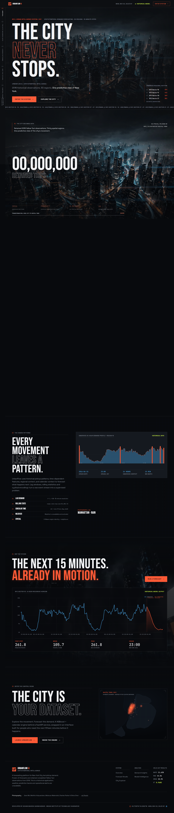
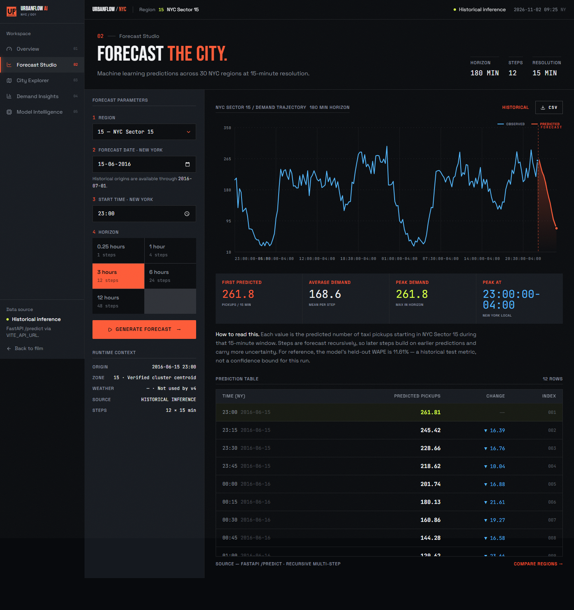
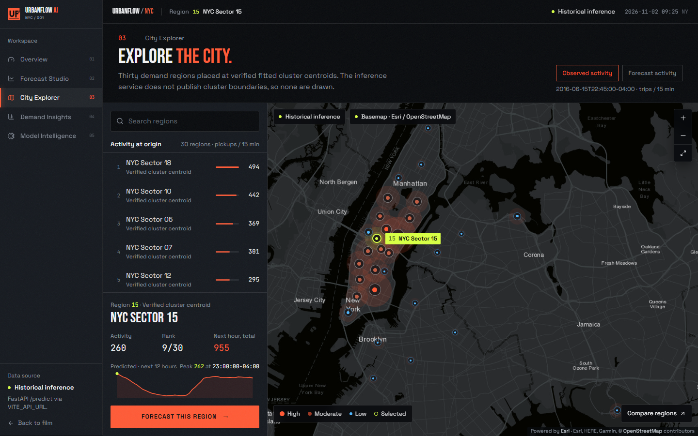
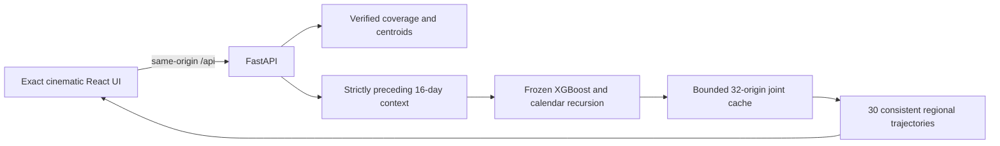

# UrbanFlow AI · Historical Forecasting Platform

UrbanFlow AI connects a cinematic React interface to a frozen, validated spatiotemporal demand model. It forecasts retained completed NYC Yellow Taxi trips across 30 fitted regions at 15-minute resolution, using genuine 2016 observations. The homepage, Overview, Forecast Studio, City Explorer, Demand Insights and Model Intelligence share the same model and data contract.

This repository is the serving application. The [research repository](https://github.com/Sohamgaonkhadkar/UBER-DEMAND-PREDICTION) contains notebooks, experiments, frozen evaluation evidence and acquisition code. No training is performed on application startup or during a prediction request.



## Validated model

The selected artifact is `backend/bundle/candidate_v4.joblib`, candidate `v4_calendar_feedback`: an XGBoost component with 599 boosted trees, a training-only calendar profile and recursive calendar feedback. Each final blended prediction is appended before the next step. The fitted ordered schema has **46 features**; the bundle's legacy top-level feature union is not used for inference.

| Cumulative horizon | Steps | June 2016 WAPE |
|---|---:|---:|
| 15 minutes | 1 | 9.7507% |
| 1 hour | 4 | 10.1260% |
| 3 hours | 12 | 11.1766% |
| 6 hours | 24 | 11.4557% |
| 12 hours | 48 | 11.6086% |

The full 12-hour evaluation has MAE **14.5595**, RMSE **23.9458**, R² **0.960489**, and bias **+2.5667%**. It covers 55 non-overlapping origins spaced 13 elapsed hours apart, 30 regions and 48 leads: **79,200 predictions**. WAPE is `100 × sum(abs(prediction − actual)) / sum(abs(actual))`, an error measure, not classification accuracy. The individual lead-48 WAPE is **13.5862%**, distinct from cumulative 12-hour WAPE. The moving-block bootstrap 95% interval for cumulative WAPE is **10.7556–12.5330%**; it is an interval for an evaluation metric, not a prediction band for a trip count.

The exact ledger is exposed at `/model/metrics` and checked in at `backend/bundle/final_test_results.json`. Tests independently recompute all five cumulative metric sets from sealed June predictions and compare portable runtime forecasts with archived predictions. This integration does not select another model or reuse June for tuning.

## Run locally

Use Python **3.14** and Node.js **22.12+ or 24**. Both model and observations are included in Git: no raw-data download, API key, research checkout or training job is needed. Only load the trusted checked-in joblib bundle; joblib is an executable serialization format.

From this repository root, in PowerShell:

```powershell
py -3.14 -m venv .venv
.venv\Scripts\python.exe -m pip install -r backend/requirements-dev.txt
.venv\Scripts\python.exe -m uvicorn main:app --app-dir backend --host 127.0.0.1 --port 8000
```

In a second terminal:

```powershell
cd frontend
npm ci
npm run dev -- --host 127.0.0.1 --port 5173
```

Open [the local application](http://127.0.0.1:5173). Vite proxies `/api` to `127.0.0.1:8000`. No environment variable is required. `frontend/.env.example` documents the default; `VITE_API_URL` can point to a separately hosted API when explicitly configured. For a direct cross-origin API URL, configure `CORS_ORIGINS` on the backend. Linux/macOS use `.venv/bin/python` in place of the Windows Python path. API documentation is at [localhost:8000/docs](http://127.0.0.1:8000/docs).

## Historical coverage and timestamp semantics

| Property | Supported value |
|---|---|
| Timezone | America/New_York |
| Observations | January 1, 2016 00:00 through June 30, 2016 23:45 |
| Training labels | January 17 through May 31, 2016 21:45 |
| Training cutoff, exclusive | May 31, 2016 22:00 |
| Valid forecast origins | May 31, 2016 22:00 through July 1, 2016 00:00 |
| Complete 12-hour comparison observations | Origins through June 30, 2016 12:00 |
| Required context | 1,536 consecutive quarter-hour bins, all 30 regions |
| Supported horizon | Integer 1–48 quarter-hour steps |

The first forecast timestamp equals the origin and represents its next 15-minute bin. Context ends strictly before the origin. An origin at the observation boundary can forecast subsequent targets without claiming they have observed outcomes. The default date comes from `/coverage`; the application's current clock is not the data timestamp. Coverage is derived at runtime from the training cutoff, available history, and data end, not a weather service's availability.

Naive timestamps are interpreted as New York civil time; explicit offsets are accepted and normalized. Ambiguous/nonexistent DST timestamps, non-quarter-hour values, unsupported horizons, out-of-range origins and real-time mode receive validation errors. No current-2026 forecasts are supported by these 2016 artifacts.

## Data provenance and scope

The observation panel aggregates original coordinate-bearing 2016 Yellow Taxi records, including June from the NYC Open Data dataset `uacg-pexx`. It preserves the research target and fixed scaler/K-means mapping. Retained trips satisfy **both pickup and dropoff** latitude `40.60–40.85`, longitude `−74.05–−73.70`, fare `$0.50–81.00` and trip distance `0.25–24.43` miles. Counts are not all taxi requests, all NYC pickups, or latent unmet demand. Fare and trip-completion filters require post-trip information; immediate availability of a completed count is an idealized benchmark assumption, not a certified live feed.

The dense observation grid retains zero bins under a source-completeness assumption. Raw feed outages cannot be certified from an aggregate count panel. The earlier DST quarantine and source processing choices remain documented in the research report. No fabricated observations are inserted to make an incomplete inference context pass.

Region IDs are the fitted model's IDs. `/regions` computes each centroid as `scaled_center × scaler_scale + scaler_mean`, retaining the original longitude/latitude order. Generic **NYC Sector 00–29** labels avoid attaching unverified neighborhoods to cluster IDs. These are point centroids; authoritative cluster polygons are unavailable. The map's cartographic/schematic backgrounds do not define model boundaries.

## Application behavior

- **Homepage and Overview:** genuine history, model forecasts and observed regional activity; no synthetic ticker, weather or demand fallback.
- **Forecast Studio:** region, date, quarter-hour and horizon controls call the frozen model. History precedes the submitted origin. CSV timestamps and rounded forecast values match the displayed/API values.
- **City Explorer:** search and selection across all 30 verified centroids, pan/zoom/reset, and explicitly labeled observed versus forecast activity. Observed activity is the bin immediately before the origin; forecast activity is the first predicted bin at the origin. The overlay shows its actual timestamp. External tile failure is labeled and falls back to schematic geography, while demand values still come from the API.
- **Demand Insights:** two genuine regional forecasts at one origin/horizon, derived summaries and genuine preceding observations. Past versus predicted summary bars refer to separate intervals, not a forecast-accuracy comparison.
- **Model Intelligence:** real backend metadata and verified June metrics. Weather, validated whole-model feature attribution, calibrated prediction intervals and operational alerts are unavailable.

The exact supplied cinematic ZIP supplies the assets, original CSS, scene sequence, typography, chart components and animation logic. Corrections change data, labels, loading/errors and functional controls. Before/after browser captures and asset hashes are in `docs/visual-baseline`, `docs/screenshots`, `docs/visual-comparison.png` and `docs/template-design-manifest.json`. Original template test sources are archived in `docs/original-template-tests`; adapted behavior tests and genuine-data acceptance tests run from `frontend/tests`.




## API

| Method | Route | Purpose |
|---|---|---|
| GET | `/health` | Loaded model and historical service status |
| GET | `/coverage` | Dynamic date limits, default origin and capability flags |
| GET | `/regions` | 30 inverse-transformed fitted centroids |
| GET | `/model/info` | Architecture, fitted schema, target and limitations |
| GET | `/model/metrics` | Verified June evaluation ledger |
| POST | `/predict` | One region's forecast and genuine preceding history |
| POST | `/predict/batch` | All 30 trajectories from one shared origin |
| GET | `/activity?datetime=…&mode=observed` | Previous observed bin across all regions |
| GET | `/activity?datetime=…&mode=forecast` | First predicted bin across all regions |
| GET | `/historical?region=…&start=…&end=…` | Genuine observations, end exclusive, maximum 4,096 bins |
| GET | `/insights?datetime=…` | Actual hourly and regional summaries of the preceding 16 days |

```json
{"region": 3, "datetime": "2016-06-15T12:00:00-04:00", "horizon": 48, "mode": "historical"}
```

`/predict` returns `forecast`, `history`, `heatmap`, `heatmap_datetime`, `heatmap_kind` and explicit capability metadata. Weather and feature importance are `null`; operational alerts are an empty list with availability `false`. Errors return an appropriate HTTP status and safe message, never replacement values or internal filesystem paths.



Each uncached origin computes a single full 48-step joint trajectory. Requests for different regions or shorter horizons reuse its prefix. A lock prevents duplicate concurrent calculations; the cache is bounded and uses immutable returned copies. CPU work executes in FastAPI's worker thread pool. Bundle hashes and the fitted ordered feature schema are validated during startup.

## Validation

```powershell
.venv\Scripts\python.exe -m pytest -q
cd frontend
npm run typecheck
npm run build
npx playwright install chromium
# Keep the real backend running on 8000; Playwright starts/reuses Vite on 4175.
npm run test:e2e
```

Tests cover sealed score recomputation, archived prediction parity, every region and supported UI horizon, causal future-data poisoning, timestamp/DST validation, incomplete requests, explicit failures, CSV value equality, map interactions, route history, mobile layout, and the cinematic scroll/reduced-motion behavior. See `FINAL_INTEGRATION_REPORT.md` for the actual executed results and limitations.

## Containers

```powershell
docker compose config --quiet
docker compose up --build
```

The frontend is built with Node and served by Nginx, which proxies `/api/` to the Python backend. Ports are 5173 and 8000. The Python image installs pinned serving dependencies and copies the compact frozen bundle. Compose configuration was validated locally. **The local Docker engine was unavailable during integration, so container build and container execution are not claimed as tested.** The equivalent clean Python environment, production frontend build, real servers and browser integration were tested.

## Repository layout and release scope

```text
backend/                 FastAPI, inference-only model compatibility modules
  bundle/                Frozen artifact, schema, genuine panel, geography, metrics, hashes
  tests/                 Actual-artifact/API tests and sealed numeric evidence
frontend/                Original cinematic React/TypeScript/Vite application
docs/                    Browser screenshots, design hashes and original test sources
compose.yaml             Local two-service deployment definition
FINAL_INTEGRATION_REPORT.md
```

No raw multi-million-trip source files, research dependencies, intermediate checkpoints, `node_modules`, Python environments or secrets belong in the serving repository. Historical versions remain in Git history. Integration is pushed to a `codex/` branch, with no default-branch update, force push or live cloud change. The June benchmark is suitable for historical analysis and demonstrations of this defined target; current operations require a compatible as-of data feed and a new validation exercise.
