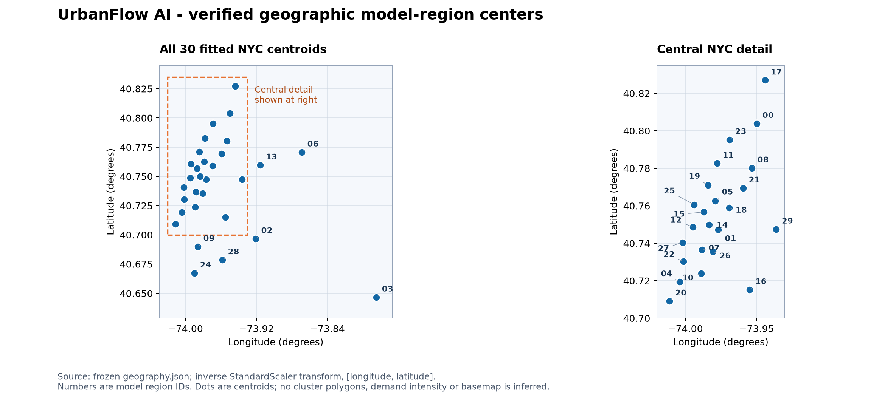
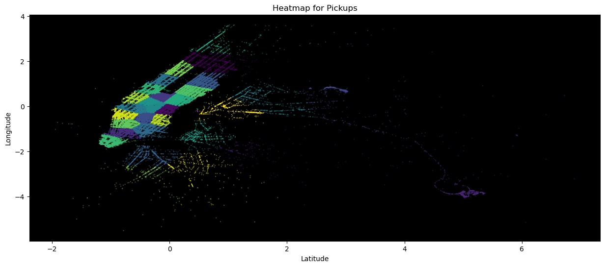
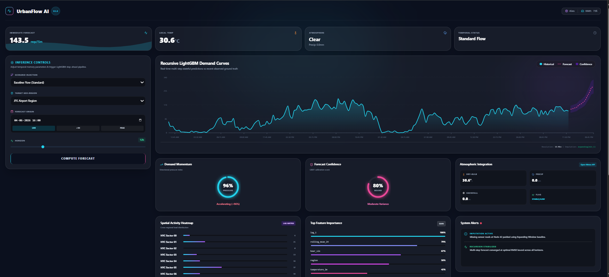
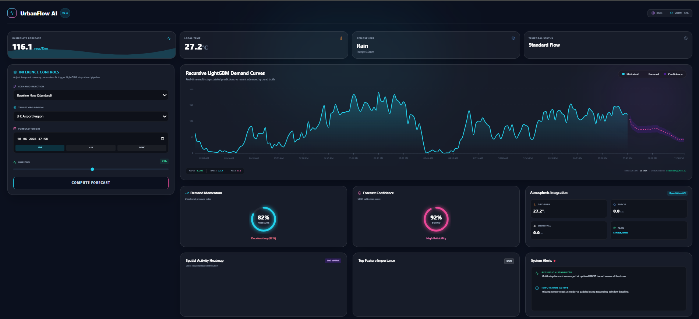
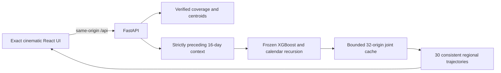

# UrbanFlow AI · Historical Forecasting Platform

[](LICENSE)


**From validated spatiotemporal research to an interactive historical forecasting
application: real observations, a frozen model, and a cinematic interface.**

UrbanFlow AI connects a cinematic React interface to a frozen, validated spatiotemporal demand model. It forecasts retained completed NYC Yellow Taxi trips across 30 fitted regions at 15-minute resolution, using genuine 2016 observations. The homepage, Overview, Forecast Studio, City Explorer, Demand Insights and Model Intelligence share the same model and data contract.

This repository is the serving application. The [research repository](https://github.com/Sohamgaonkhadkar/UBER-DEMAND-PREDICTION/tree/main) contains notebooks, experiments, frozen evaluation evidence and acquisition code. No training is performed on application startup or during a prediction request.


**Live application:** [urbanflow-ai-rose.vercel.app](https://urbanflow-ai-rose.vercel.app) · [API health](https://urbanflow-ai-rose.vercel.app/api/health)

## Platform at a glance

| Dimension | Delivered capability |
|---|---|
| Forecasting | 30 NYC regions; 15-minute resolution; 1–48 step horizons |
| Model | Frozen XGBoost + recursive calendar feedback; 46 fitted features |
| Verified error | 9.7507% WAPE at 15 minutes; 11.6086% cumulative WAPE across 12 hours |
| Observation panel | 66,874,467 retained historical trips; 524,040 region/time rows |
| Interface | Cinematic homepage and five connected application pages |
| Backend | FastAPI with typed requests, causal context validation and a shared joint cache |
| Reproducibility | Checked-in model, observations, schema, checksums and pinned dependencies |
| Failure handling | Explicit unavailable/error states; no generated demand fallback |

## Contents

- [Validated model](#validated-model)
- [Run locally](#run-locally)
- [Historical coverage and timestamp semantics](#historical-coverage-and-timestamp-semantics)
- [Data provenance and scope](#data-provenance-and-scope)
- [Application behavior](#application-behavior)
- [Maps and interface history](#maps-and-interface-history)
- [Weather-aware forecasts](#weather-aware-forecasts)
- [Forecasting mathematics](#forecasting-mathematics)
- [API](#api)
- [Validation](#validation)
- [Containers](#containers)
- [Troubleshooting](#troubleshooting)
- [Repository layout and release scope](#repository-layout-and-release-scope)
- [License and third-party materials](#license-and-third-party-materials)


## Validated model

The selected artifact is `backend/bundle/candidate_v4.joblib`, candidate `v4_calendar_feedback`: an XGBoost component with 599 boosted trees, a training-only calendar profile and recursive calendar feedback. Each final blended prediction is appended before the next step. The fitted ordered schema has **46 features**; the bundle's legacy top-level feature union is not used for inference.

| Cumulative horizon | Steps | June 2016 WAPE |
|---|---:|---:|
| 15 minutes | 1 | 9.7507% |
| 1 hour | 4 | 10.1260% |
| 3 hours | 12 | 11.1766% |
| 6 hours | 24 | 11.4557% |
| 12 hours | 48 | 11.6086% |

The full 12-hour evaluation has MAE **14.5595**, RMSE **23.9458**, R² **0.960489**, and bias **+2.5667%**. It covers 55 non-overlapping origins spaced 13 elapsed hours apart, 30 regions and 48 leads: **79,200 predictions**. WAPE is `100 × sum(abs(prediction − actual)) / sum(abs(actual))`, an error measure, not classification accuracy. The individual lead-48 WAPE is **13.5862%**, distinct from cumulative 12-hour WAPE. The moving-block bootstrap 95% interval for cumulative WAPE is **10.7556–12.5330%**; it is an interval for an evaluation metric, not a prediction band for a trip count.

The exact ledger is exposed at `/model/metrics` and checked in at `backend/bundle/final_test_results.json`. Tests independently recompute all five cumulative metric sets from sealed June predictions and compare portable runtime forecasts with archived predictions. This integration does not select another model or reuse June for tuning.

## Run locally

Use Python **3.14** and Node.js **22.12+ or 24**. Both model and observations are included in Git: no raw-data download, API key, research checkout or training job is needed. Only load the trusted checked-in joblib bundle; joblib is an executable serialization format.

The completed platform is available on the repository's `main` branch.
Clone that branch while the default branch retains the earlier version:

```powershell
git clone --branch main https://github.com/Sohamgaonkhadkar/UrbanFlow-AI-Spatiotemporal-Demand-Forecasting-Platform.git Deployment-Platform
cd Deployment-Platform
```

From this repository root, create the backend environment and start the API:


```powershell
py -3.14 -m venv .venv
.venv\Scripts\python.exe -m pip install -r backend/requirements-dev.txt
.venv\Scripts\python.exe -m uvicorn main:app --app-dir backend --host 127.0.0.1 --port 8000
```

In a second terminal:

```powershell
cd frontend
npm ci
npm run dev -- --host 127.0.0.1 --port 5173
```

Open [the local application](http://127.0.0.1:5173). Vite proxies `/api` to `127.0.0.1:8000`. No environment variable is required. `frontend/.env.example` documents the default; `VITE_API_URL` can point to a separately hosted API when explicitly configured. For a direct cross-origin API URL, configure `CORS_ORIGINS` on the backend. Linux/macOS use `.venv/bin/python` in place of the Windows Python path. API documentation is at [localhost:8000/docs](http://127.0.0.1:8000/docs).

## Historical coverage and timestamp semantics

| Property | Supported value |
|---|---|
| Timezone | America/New_York |
| Observations | January 1, 2016 00:00 through June 30, 2016 23:45 |
| Training labels | January 17 through May 31, 2016 21:45 |
| Training cutoff, exclusive | May 31, 2016 22:00 |
| Valid forecast origins | May 31, 2016 22:00 through July 1, 2016 00:00 |
| Complete 12-hour comparison observations | Origins through June 30, 2016 12:00 |
| Required context | 1,536 consecutive quarter-hour bins, all 30 regions |
| Supported horizon | Integer 1–48 quarter-hour steps |

The first forecast timestamp equals the origin and represents its next 15-minute bin. Context ends strictly before the origin. An origin at the observation boundary can forecast subsequent targets without claiming they have observed outcomes. The default date comes from `/coverage`; the application's current clock is not the data timestamp. Coverage is derived at runtime from the training cutoff, available history, and data end, not a weather service's availability.

Naive timestamps are interpreted as New York civil time; explicit offsets are accepted and normalized. Ambiguous/nonexistent DST timestamps, non-quarter-hour values, unsupported horizons, out-of-range origins and real-time mode receive validation errors. No current-2026 forecasts are supported by these 2016 artifacts.

## Data provenance and scope

The observation panel aggregates original coordinate-bearing 2016 Yellow Taxi records, including June from the NYC Open Data dataset `uacg-pexx`. It preserves the research target and fixed scaler/K-means mapping. Retained trips satisfy **both pickup and dropoff** latitude `40.60–40.85`, longitude `−74.05–−73.70`, fare `$0.50–81.00` and trip distance `0.25–24.43` miles. Counts are not all taxi requests, all NYC pickups, or latent unmet demand. Fare and trip-completion filters require post-trip information; immediate availability of a completed count is an idealized benchmark assumption, not a certified live feed.

The dense observation grid retains zero bins under a source-completeness assumption. Raw feed outages cannot be certified from an aggregate count panel. The earlier DST quarantine and source processing choices remain documented in the research report. No fabricated observations are inserted to make an incomplete inference context pass.

Region IDs are the fitted model's IDs. `/regions` computes each centroid as `scaled_center × scaler_scale + scaler_mean`, retaining the original longitude/latitude order. Each centroid now has a coordinate-derived **neighborhood or landmark name** from the official NYC 2020 NTA containing that point. Original model IDs remain visible. These are approximate area labels, not inferred cluster boundaries. These are point centroids; authoritative cluster polygons are unavailable. The map's cartographic/schematic backgrounds do not define model boundaries.

## Application behavior

- **Homepage and Overview:** genuine history, model forecasts and observed regional activity; no synthetic ticker, weather or demand fallback.
- **Forecast Studio:** region, date, quarter-hour and horizon controls call the frozen model. History precedes the submitted origin. CSV timestamps and rounded forecast values match the displayed/API values.
- **City Explorer:** search and selection across all 30 verified centroids, pan/zoom/reset, and explicitly labeled observed versus forecast activity. Observed activity is the bin immediately before the origin; forecast activity is the first predicted bin at the origin. The overlay shows its actual timestamp. External tile failure is labeled and falls back to schematic geography, while demand values still come from the API.
- **Demand Insights:** two genuine regional forecasts at one origin/horizon, derived summaries and genuine preceding observations. Past versus predicted summary bars refer to separate intervals, not a forecast-accuracy comparison.
- **Model Intelligence:** real backend metadata and verified June metrics. Historical weather context and the optional weather model are available. Validated whole-model feature attribution, calibrated prediction intervals and operational alerts remain unavailable.

The supplied cinematic design retains its original CSS, scene sequence, typography, chart components and animation logic. The five homepage photographs match the approved reference recording; see [photo provenance](docs/photo-provenance.json). Source photos live in `frontend/src/assets` and are inlined into the build, with matching public copies for existing image URLs. The earlier template hash manifest and baseline screenshots document the original integration before this requested photo refresh. Corrections change data, labels, loading/errors and functional controls. Before/after browser captures and asset hashes are in `docs/visual-baseline`, `docs/screenshots`, `docs/visual-comparison.png` and `docs/template-design-manifest.json`. Original template test sources are archived in `docs/original-template-tests`; adapted behavior tests and genuine-data acceptance tests run from `frontend/tests`.

<table>
  <tr>
    <td width="50%"><strong>Forecast Studio</strong><br></td>
    <td width="50%"><strong>City Explorer</strong><br></td>
  </tr>
</table>

<details>
<summary>View the mobile homepage</summary>


</details>

Full browser captures are available in [screenshots](docs/screenshots/). Image
identity, source links and photographer credits are recorded in
[photo provenance](docs/photo-provenance.json) and
[third-party notices](THIRD_PARTY_NOTICES.md).

## Maps and interface history

### Current model geography



The current map uses the frozen scaler/centers and the model's actual region IDs.
The figure displays centroids in geographic degrees; it does not invent cluster
polygons or demand values. The interactive application map is shown in the
current City Explorer screenshot above.

<details>
<summary>Original pickup-cluster figure from the research README</summary>



This is the earlier notebook figure, retained unchanged. Its axes use transformed
coordinates rather than geographic degrees; original labels are preserved as
historical material. The verified geographic centers are shown above.

</details>

### Earlier dashboard designs

The following screenshots are retained from the previous repository READMEs.
They document the earlier LightGBM/weather interface. Their confidence gauges,
weather/KPI labels and alert panels are **historical interface elements**, not
evidence of v4 prediction intervals, operational alerts or live weather inputs.
The current application and its verified capabilities are described above.



<details>
<summary>View the earlier dashboard revision and archived demonstrations</summary>



- [Demonstration linked by the previous README](https://github.com/user-attachments/assets/6c0cd1eb-78aa-4e55-aa77-2dc26a57d7ca)
- [Earlier demonstration linked in repository history](https://github.com/user-attachments/assets/417190e9-09c5-468f-8820-32502f995822)

These recordings are historical demonstrations, not current deployment status
or validation evidence. Original image locations, source revisions and hashes
are recorded in [historical visual provenance](docs/legacy/provenance.json).

</details>

## Weather-aware forecasts

Use the **Forecast model** selector in the application header to choose
**Validated v4** or **Weather-aware · experimental**. Weather mode actually uses
six lagged ERA5 weather inputs in a separately trained 52-feature model.
Temperature, rain, wind and humidity panels display genuine historical API data.
The map forecast layer, charts, model metrics and CSV provenance follow the
selected model. All regions now display coordinate-verified neighborhood or
landmark names alongside their original region IDs.

| Model | 15-minute WAPE | Cumulative 12-hour WAPE | Evidence |
|---|---:|---:|---|
| Frozen v4 (default) | 9.7507% | 11.6086% | Original frozen June evaluation |
| Weather-aware extension | 9.6992% | 11.4395% | Reused June diagnostic data; experimental |

Weather mode's May development gain was below the predeclared promotion
threshold, so it does not silently replace v4. Its inputs are at least three
hours before each origin and remain fixed across the horizon. ERA5 is
retrospective historical reconstruction, not a weather forecast issued in 2016;
its original publication availability is not certified. One NYC reference
location supplies the weather, rather than neighborhood-specific stations.
Read the [data, methods and limitations](docs/weather-and-region-names.md).

The API accepts `model_variant: "baseline"` (default) or `"weather"` in single
and batch forecast requests and in the forecast activity query. `GET /weather`
returns the selected origin's lagged context. `/model/info` and `/model/metrics`
include separate weather-mode metadata and diagnostics.

## Forecasting mathematics

### Regional counts and verified coordinates

With $`\Delta=15`$ minutes, the target $`y_{r,t}`$ counts retained completed trips
assigned to model region $`r`$ whose pickup timestamps fall in $`[t,t+\Delta)`$.
The serving API reconstructs centroid coordinates from the fixed standardized
K-means centers:

```math
p_r^{\mathrm{center}}=\mu+\sigma\odot c_r,\qquad
p_r=\left[\mathrm{longitude}_r,\mathrm{latitude}_r\right]^{\mathsf{T}}.
```

The transform uses the stored scaler mean $`\mu`$ and scale $`\sigma`$ in
`backend/bundle/geography.json`; $`\odot`$ is elementwise multiplication.
Inference keeps the original mapping rather than reclustering the city.

### Recursive calendar feedback

For origin $`\tau`$ and zero-based lead $`k=0,\ldots,47`$, let $`b_{r,k}`$ be the
base model's original-count-scale prediction, $`s_{r,k}`$ its historical seasonal
anchor and $`c_{r,k}`$ the training-only calendar profile with causal origin-local
adaptation. The frozen coefficients define:

```math
\lambda_k=0.3\frac{k}{47},\qquad
a_{r,k}=(1-\lambda_k)b_{r,k}+\lambda_k s_{r,k},\qquad
w_k=0.6\left(1-e^{-k/12}\right).
```

```math
\widehat y_{r,k}=\max\left(0,(1-w_k)a_{r,k}+w_k c_{r,k}\right),
\qquad \widetilde y_{r,\tau+k\Delta}\leftarrow\widehat y_{r,k}.
```

Only observations strictly before the origin initialize the 1,536-bin context.
Each final prediction enters the next step's history. Computing the full joint
trajectory once makes all region requests and shorter horizon prefixes agree.
The detailed lag, rolling-statistic, EWMA, cyclic-encoding and calendar-gain
equations are documented in the companion research README's
[mathematical formulation](https://github.com/Sohamgaonkhadkar/UBER-DEMAND-PREDICTION/blob/main/README.md#mathematical-formulation) section.

### What the evaluation scores mean

For $`N`$ evaluated predictions and errors $`e_i=\widehat y_i-y_i`$:

```math
\mathrm{MAE}=\frac{1}{N}\sum_{i=1}^{N}|e_i|,\qquad
\mathrm{RMSE}=\sqrt{\frac{1}{N}\sum_{i=1}^{N}e_i^2}.
```

```math
\mathrm{WAPE}(\%)=100\,
\frac{\sum_{i=1}^{N}|e_i|}{\sum_{i=1}^{N}|y_i|},\qquad
R^2=1-\frac{\sum_{i=1}^{N}e_i^2}{\sum_{i=1}^{N}(y_i-\overline{y})^2}.
```

June's pooled evaluation has $`N=55\times30\times48=79{,}200`$. The 11.6086%
12-hour WAPE pools every lead; the individual lead-48 WAPE is 13.5862%.
WAPE is not classification accuracy. The bootstrap metric interval does not
provide count-level prediction bands.

## API

| Method | Route | Purpose |
|---|---|---|
| GET | `/health` | Loaded model and historical service status |
| GET | `/coverage` | Dynamic date limits, default origin and capability flags |
| GET | `/regions` | 30 inverse-transformed fitted centroids with verified area names |
| GET | `/weather?datetime=…` | Genuine lagged historical ERA5 weather context |
| GET | `/model/info` | Architecture, fitted schema, target and limitations |
| GET | `/model/metrics` | Verified June evaluation ledger |
| POST | `/predict` | One region's forecast and genuine preceding history |
| POST | `/predict/batch` | All 30 trajectories from one shared origin |
| GET | `/activity?datetime=…&mode=observed` | Previous observed bin across all regions |
| GET | `/activity?datetime=…&mode=forecast` | First predicted bin across all regions |
| GET | `/historical?region=…&start=…&end=…` | Genuine observations, end exclusive, maximum 4,096 bins |
| GET | `/insights?datetime=…` | Actual hourly and regional summaries of the preceding 16 days |

```json
{"region": 3, "datetime": "2016-06-15T12:00:00-04:00", "horizon": 48, "mode": "historical"}
```

### Make a forecast request

With the backend running, PowerShell:

```powershell
$body = @{
  region = 3
  datetime = '2016-06-15T12:00:00-04:00'
  horizon = 48
  mode = 'historical'
} | ConvertTo-Json

$result = Invoke-RestMethod -Method Post `
  -Uri 'http://127.0.0.1:8000/predict' `
  -ContentType 'application/json' `
  -Body $body

$result.forecast | Select-Object -First 4
```

The request chooses model region 3 at an explicit New York historical origin.
The response contains 48 quarter-hour predictions; changing the selected region
or requesting a shorter horizon reuses the same joint origin trajectory.

`/predict` returns `forecast`, `history`, `heatmap`, `heatmap_datetime`, `heatmap_kind` and explicit capability metadata. `weather` contains genuine lagged ERA5 context and a `model_used` flag; feature importance is `null`. Operational alerts are an empty list with availability `false`. Errors return an appropriate HTTP status and safe message, never replacement values or internal filesystem paths.



Each uncached origin computes a single full 48-step joint trajectory. Requests for different regions or shorter horizons reuse its prefix. A lock prevents duplicate concurrent calculations; the cache is bounded and uses immutable returned copies. CPU work executes in FastAPI's worker thread pool. Bundle hashes and the fitted ordered feature schema are validated during startup.

## Validation

```powershell
.venv\Scripts\python.exe -m pytest -q
cd frontend
npm run typecheck
npm run build
npx playwright install chromium
# Keep the real backend running on 8000; Playwright starts/reuses Vite on 4175.
npm run test:e2e
```

Recorded integration results: **22 deployment tests**, **37 full browser
tests**, **150 actual HTTP forecasts**, and **eight invalid-request rejections**.
The subsequent photo refresh verified all five exact image hashes and production
inlining, plus the 21 existing cinematic/navigation checks; one initial homepage
load timeout passed twice on an unchanged rerun. See the
[integration report](FINAL_INTEGRATION_REPORT.md) and
[photo refresh record](docs/PHOTO_REFRESH.md) for execution details.

Tests cover sealed score recomputation, archived prediction parity, every region and supported UI horizon, causal future-data poisoning, timestamp/DST validation, incomplete requests, explicit failures, CSV value equality, map interactions, route history, mobile layout, and the cinematic scroll/reduced-motion behavior. See `FINAL_INTEGRATION_REPORT.md` for the actual executed results and limitations.

## Containers

```powershell
docker compose config --quiet
docker compose up --build
```

The frontend is built with Node and served by Nginx, which proxies `/api/` to the Python backend. Ports are 5173 and 8000. The Python image installs pinned serving dependencies and copies the compact frozen bundle. Compose configuration was validated locally. **The local Docker engine was unavailable during integration, so container build and container execution are not claimed as tested.** The equivalent clean Python environment, production frontend build, real servers and browser integration were tested.

## Vercel deployment

The full application is deployed at [urbanflow-ai-rose.vercel.app](https://urbanflow-ai-rose.vercel.app).
Public frontend/API checks and a 48-step cloud forecast passed; rounded predictions
matched the local frozen artifact exactly for the recorded test request. See the
[deployment validation record](docs/vercel-validation.json) for scope and commit.


Import this repository using the `main` branch and
keep the **Root Directory at the repository root**, not `frontend/`.
`vercel.json` selects FastAPI and builds the cinematic frontend with `npm ci`
and `npm run build`. Python is pinned to 3.14. No API keys or raw-data downloads
are required. Leave `VITE_API_URL` unset so the frontend uses same-origin `/api`.

The root `app.py` starts the original backend lifespan, mounts its API at
`/api`, and serves `frontend/dist` at `/`. It retains the frozen model and
observations, including their checksum verification. Vercel's FastAPI integration
can promote the static frontend files to its CDN. The Vercel requirements use the
same-version CPU-only XGBoost distribution to avoid shipping GPU libraries.
Existing local and Docker commands continue to use `backend/requirements.txt`.

After deployment, verify `/`, `/api/health`, `/api/coverage`, `/api/regions`, and
an actual `POST /api/predict` before relying on the site. A successful frontend
build alone does not verify hosted model inference. Requests may have a cold
start; the function timeout is 300 seconds. The target is still the documented
historical June benchmark, not current live demand.

References: [Vercel FastAPI deployment](https://vercel.com/docs/frameworks/backend/fastapi),
[Python runtime](https://vercel.com/docs/functions/runtimes/python), and
[XGBoost CPU installation](https://xgboost.readthedocs.io/en/stable/install.html).

## Troubleshooting

| Symptom | Action |
|---|---|
| Current date is rejected | Use an origin returned by `/coverage`; this model supports historical 2016 inference. |
| Homepage reports an unavailable service | Start the backend on port 8000, then check `/health` and `/coverage`. |
| Import error for `main`, `service` or `ml` | Run the documented Uvicorn command from the repository root with `--app-dir backend`. |
| Model or checksum validation fails | Recover the complete trusted bundle from the same repository revision; do not fill missing features or substitute another checkpoint. |
| Dependency/native-library mismatch | Use Python 3.14 and the pinned serving requirements in a clean environment. |
| External map tiles do not load | The labeled schematic fallback remains available; model predictions still come from the local API. |
| Direct API URL fails CORS | Set `CORS_ORIGINS` for that frontend origin, or use the default same-origin `/api` proxy. |
| Docker reports a missing engine pipe | Start the local Docker engine, or use the verified two-terminal Python/Vite workflow. Container execution remains unverified for the recorded integration. |

PowerShell activation-policy changes are unnecessary: the commands invoke the
virtual environment's Python executable directly. Do not put secrets in frontend
`VITE_` variables; those values are included in the browser build.

## Repository layout and release scope

```text
backend/                 FastAPI, inference-only model compatibility modules
  bundle/                Frozen artifact, schema, genuine panel, geography, metrics, hashes
  tests/                 Actual-artifact/API tests and sealed numeric evidence
frontend/                Original cinematic React/TypeScript/Vite application
docs/                    Browser screenshots, design hashes and original test sources
compose.yaml             Local two-service deployment definition
FINAL_INTEGRATION_REPORT.md
LICENSE                  MIT license for original software/documentation
THIRD_PARTY_NOTICES.md    Photo, data, map, font and dependency notices
```

No raw multi-million-trip source files, research dependencies, intermediate checkpoints, `node_modules`, Python environments or secrets belong in the serving repository. Historical versions remain in Git history. The completed integration is available on `main` after review through its pull request. The full-stack application is now deployed on Vercel; the validation record above documents its hosted checks. The June benchmark is suitable for historical analysis and demonstrations of this defined target; current operations require a compatible as-of data feed and a new validation exercise.

## License and third-party materials

Original UrbanFlow AI software and documentation are available under the
[MIT License](LICENSE), copyright © 2026 Soham Mahesh Gaonkhadkar.
Third-party photographs, source datasets, map services, fonts and dependencies
retain their applicable terms; see [third-party notices](THIRD_PARTY_NOTICES.md).

## Author

**Soham Mahesh Gaonkhadkar** · [GitHub](https://github.com/Sohamgaonkhadkar)
